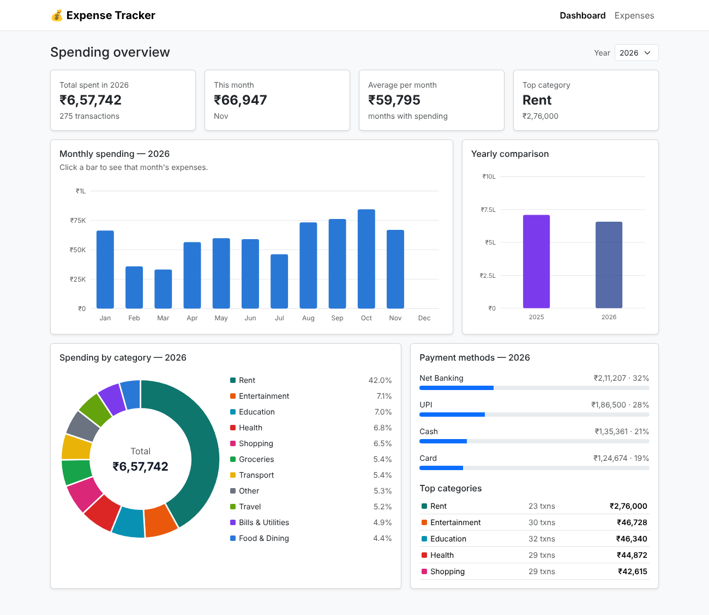

# Expense Tracker with Analytics Dashboard

A React.js application to record, edit and manage personal expenses, with an analytics dashboard that visualises monthly and yearly spending patterns. Expense records are stored in and retrieved from MongoDB.

**Technologies used:** React.js · JavaScript · Bootstrap · Data Visualization (custom SVG charts) · MongoDB



## Features

**Expense management**
- Add, edit and delete expenses (description, amount, category, payment method, date, notes)
- Client-side and server-side validation (positive amounts, valid categories, no future dates)
- Filter by month and category, and search descriptions/notes (debounced)
- Running total for the filtered list

**Analytics dashboard**
- KPI cards: total spent in the year, this month's spend, average per month, top category
- **Monthly spending bar chart** — click any month to jump to that month's expenses
- **Yearly comparison chart** — click a year to switch the whole dashboard to it
- **Category donut chart** with an interactive legend and percentages
- Payment method split and top-5 categories table
- All charts are hand-built with React + SVG in plain JavaScript (no charting library), including scales, axis ticks, arcs and tooltips

**MongoDB**
- Expenses stored in an `expenses` collection with indexes on `date` and `category`
- Dashboard numbers come from MongoDB **aggregation pipelines** (`$match`, `$group`, `$month`, `$year`, `$sum`)
- A seed script generates ~14 months of realistic sample data

## How it fits together

```
React.js + Bootstrap  ──fetch /api──►  small Node API layer  ──►  MongoDB
   (client/)                            (server/)                (expenses collection)
```

Browsers can't connect to MongoDB directly, so `server/` is a thin JSON API written with Node's built-in `http` module and the official MongoDB driver — no framework.

| Method | Endpoint              | Description                                         |
|--------|-----------------------|-----------------------------------------------------|
| GET    | `/api/expenses`       | List expenses. Query: `month=YYYY-MM`, `category`, `search` |
| POST   | `/api/expenses`       | Create an expense                                   |
| PUT    | `/api/expenses/:id`   | Update an expense                                   |
| DELETE | `/api/expenses/:id`   | Delete an expense                                   |
| GET    | `/api/analytics`      | Dashboard data for `?year=YYYY`                     |
| GET    | `/api/meta`           | Categories and payment methods                      |

## Project structure

```
expense-tracker-dashboard/
├── client/
│   └── src/
│       ├── charts/
│       │   ├── BarChart.jsx      # SVG bar chart with tooltips and click handling
│       │   └── DonutChart.jsx    # SVG donut chart built from arc paths
│       ├── components/
│       │   ├── Dashboard.jsx     # KPIs + all charts
│       │   ├── ExpenseList.jsx   # filters + table + edit/delete
│       │   └── ExpenseForm.jsx   # add / edit form with validation
│       ├── api.js
│       ├── utils.js              # INR formatting, dates, category colours
│       └── App.jsx
└── server/
    └── src/
        ├── index.js              # REST routes + aggregation queries
        ├── validation.js
        ├── db.js
        └── seed.js               # sample data generator
```

## How to run locally

**Prerequisites:** Node.js 20.6 or later and MongoDB running locally (or a MongoDB Atlas connection string).

1. **Start the API**
   ```bash
   cd server
   npm install
   cp .env.example .env     # edit MONGODB_URI if needed
   npm run seed             # optional: load sample data
   npm run dev
   ```
2. **Start the React app** (in a second terminal)
   ```bash
   cd client
   npm install
   npm run dev
   ```
3. Open http://localhost:5174
